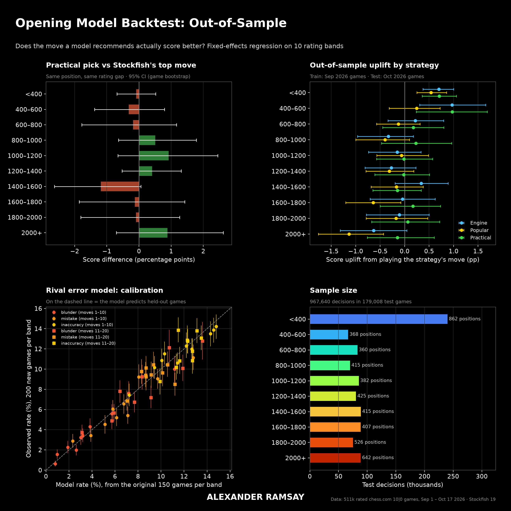
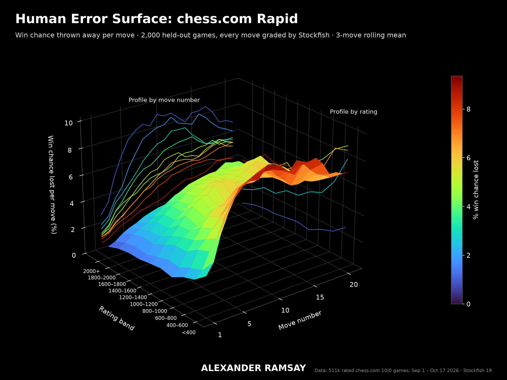

# Gambito: an opening model for real (not perfect) opponents, backtested

**Live site:** https://alexanderramsay278.github.io/gambito/ (a Duolingo-style opening trainer that runs entirely in the browser)

Chess engines answer "what is the best move against a perfect opponent?". Most games aren't played against perfect opponents. This project asks a narrower, testable question:

> At a given rating, does choosing opening moves by **expected score against how players at that rating actually reply** beat simply playing Stockfish's top move?

It is built from **511,000 rated chess.com 10-minute games** across **10 rating bands** (Under 400 to 2000+, Sep 1 – Oct 17 2026), with Stockfish 19 evaluations.

**Answer: no.** The "practical" model does not beat Stockfish's top move in any band. At most ratings, opening move choice shifts the final score by under one percentage point. Games are mostly lost in moves 11–20.




## The model
For each position reached often enough at a rating band:
- **Engine:** Stockfish 19's best move (depth 12).
- **Popular:** the move players at that band choose most often.
- **Practical:** among moves within 4 win-percentage points of Stockfish's best, the one with the highest expected win chance against the band's **empirical reply distribution** (one-ply lookahead):

  `practical = argmax_m  Σ_r  P(reply r | m, band) · W(position after m, r)`,  with `W(cp) = 1 / (1 + e^(−0.00368·cp))`

## Backtest design
- **Time split, no overlap.** Strategies are built from **September** games (298,868 games) and evaluated on games from **1 October** onwards (179,008 games; 967,640 decisions at 4,802 positions, first 8 moves).
- **Outcome:** the player's final score (1 / ½ / 0).
- **Estimator:** `score = β·followed + γ·rating_gap + position fixed effect`, fitted by OLS after demeaning within each position. In words: at the same position and the same rating gap, how much more do players score when they play the strategy's move?
- **Uncertainty:** 95% CIs from a **cluster bootstrap over games** (400 resamples). Decisions from one game share one result, so they aren't independent.
- **Head-to-head:** at the positions where Practical ≠ Engine, players who chose one are compared with players who chose the other.

## Results
| Band | Practical − Engine (score pp) | 95% CI |
|---|---|---|
| Under 400 | −0.09 | −0.69 to +0.52 |
| 400–600 | −0.32 | −1.38 to +0.80 |
| 600–800 | −0.18 | −1.78 to +1.16 |
| 800–1000 | +0.51 | −0.64 to +1.78 |
| 1000–1200 | +0.92 | −0.66 to +2.45 |
| 1200–1400 | +0.41 | −0.53 to +1.31 |
| 1400–1600 | −1.19 | −2.63 to +0.06 |
| 1600–1800 | −0.13 | −1.86 to +1.42 |
| 1800–2000 | −0.09 | −1.81 to +1.27 |
| 2000+ | +0.89 | −0.70 to +2.62 |

- **No band shows a significant difference** between the practical pick and Stockfish's top move.
- **Following Stockfish** is worth +0.7 pp (CI +0.4 to +1.0) at Under 400 and +1.0 pp (+0.3 to +1.7) at 400–600. Elsewhere every strategy is within about ±1 pp of zero.
- **Playing the most popular move is significantly negative** at 1600–1800 (−0.6 pp) and 2000+ (−1.1 pp, CI −1.8 to −0.4).
- **Error surface:** average win chance lost per move rises from moves 1–10 to moves 11–20 at every rating (Under 400: 7.2% → 8.3%; 2000+: 2.0% → 3.9%).
- **Error-model calibration:** per-band mistake rates measured on 150 games predict 200 new held-out games with a mean absolute gap of 0.97 pp (100 rates). 74 of 100 fall inside the new sample's 95% CI, so the model is roughly but not perfectly calibrated.

Full numbers: [`results/`](results/) (one JSON per band).

## Limitations
- **Observational, not causal.** Position and rating gap are controlled; skill differences within a band are not.
- **One month of test data.** The time split guards against overfitting, not against changes in the player pool.
- **Small true effects can't be detected:** below about 0.5 pp, the CIs are too wide.
- **Only the first 20 moves of each game are stored,** and grading uses depths 10–12.

## The website
`docs/` is the static site (GitHub Pages; it also runs by opening `docs/index.html` from disk):
- **Lessons** per rating band, with the official opening name of every line, a "why it's good" summary, and a plain-English purpose for every move.
- **"Play it out"** games against a rival that samples real move frequencies in the opening. After the opening it makes mistakes at that band's measured rates.
- **Live grading** of your moves by Stockfish 19 (WebAssembly) in the browser.

## Reproduce
```bash
pip install -r requirements.txt          # plus Stockfish 19 (STOCKFISH_PATH) and esbuild (ESBUILD_PATH)
cd pipeline
python bands_crawl.py 40000              # ~40k games per band from the chess.com public API -> data/ (not in git)
python crawl.py                          # the Under 400 sample
python site_data.py                      # books, error models, courses -> docs/data/
python site_build.py                     # bundle the site
python backtest.py && python charts.py   # the out-of-sample tests and figures
python site_selftest.py                  # 163 checks in a headless browser
```
Raw games are not published. They contain player usernames, and anyone can re-download them from the public API.

## Licences
- **Code:** GPL-3.0 (see `LICENSE`), because the site ships Stockfish (GPL-3, stockfish.js by Nathan Rugg).
- **Other components:** chess.js (BSD-2), cburnett pieces (GPL-2+), Nunito (OFL), opening names from lichess-org/chess-openings (CC0). See `docs/LICENSES.txt`.
- **Game data:** aggregated from the chess.com Published-Data API.
